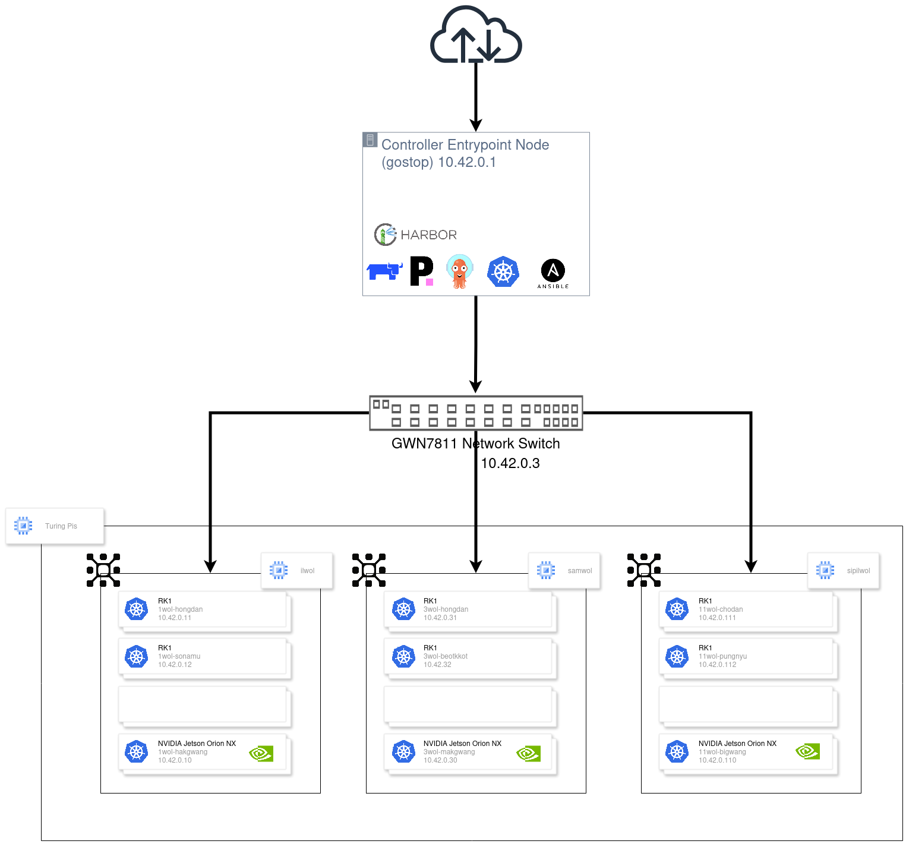

# Jihwija

<p align="center">
  
</p>

<p align="center">
  <a href="https://www.python.org/"></a>
  <a href="https://www.ansible.com/"></a>
  <a href="https://k3s.io/"></a>
  <a href="https://ubuntu.com/"></a>
  <a href="LICENSE"></a>
</p>

Bak (Korean: 박; Hanja: 拍) is a wooden clapper used in Korean court and ritual music. The person playing the bak is called jipbak, serving as the conductor or musical supervisor for the group. More generally called a Jihwija (지휘자, “conductor”).

Jihwija turns a collection of Ubuntu machines into a managed, multi-user K3s cluster. It is a thin Python CLI over native Ansible, K3s, Kubernetes, Kustomize, and Helm tooling: the underlying playbooks, manifests, and plumbing scripts remain directly available to maintainers.

Jihwija provides:

- **Single-Server K3s Provisioning:** Automated deployment and lifecycle management via native Ansible playbooks.
- **Node Management:** Safe worker-node addition, validation, cordoning, draining, and removal.
- **Turnkey Platform Services:** Integrated deployment of Rancher, Harbor registry, Portainer, Argo Workflows, cert-manager, and NVIDIA GPU device plugin.
- **Service Certificate Trust:** Automatic cluster-wide distribution of TLS certificates and private CAs to OS trust stores, Chromium policies, and containerd registries.
- **Multi-Tenant User Isolation:** Unified user provisioning across Linux, filesystem quotas, rootless Docker daemons, Portainer Agent endpoints, K3s namespaces with ResourceQuotas, Argo Workflows runners, Harbor registry projects, and Rancher projects.


<p align="center">
    Example of using Jihwija on a multi-node cluster
</p>

## Documentation

Comprehensive operational and architecture guides are available in [`docs/`](docs/):

| Guide | Description |
| :--- | :--- |
| **[Cluster Setup Guide](docs/SETUP.md)** | Step-by-step walkthrough for cluster initialization, K3s provisioning, service deployment, and node management via the Jihwija CLI or manual native pipelines. |
| **[User Setup Guide](docs/SETUP_USERS.md)** | Dedicated guide for multi-tenant user provisioning, filesystem/K3s quotas, password updates, and service integrations. |
| **[Web UI Tunneling](docs/TUNNELING.md)** | Instructions for accessing cluster dashboards (Rancher, Harbor, Portainer, Argo) from remote workstations via SOCKS5 proxy. |
| **[Deploying an Argo Workflow](docs/DEPLOYING_ARGO_WORKFLOW.md)** | Guide to running batch tasks, ML workflows, and containerized pipelines with namespace runners. |
| **[Adding a New Node](docs/ADDING_A_NEW_NODE.md)** | Hardware and OS preparation for Turing Pi RK1, Raspberry Pi, or generic x86 worker nodes. |
| **[Adding a Jetson Orin](docs/ADDING_A_JETSON_ORIN.md)** | Preparing NVIDIA Jetson Orin modules with GPU drivers and container runtimes. |

Component-specific technical references:
- **[Ansible Playbooks](ansible/README.md):** Directly runnable playbooks and inventory specifications.
- **[Cluster Services](jihwija-services/README.md):** Kustomize overlays and HelmChart definitions.
- **[Plumbing Scripts](scripts/README.md):** Directly executable maintainer scripts powering the CLI.

---

## Install

Run the installer from a release checkout on the Ubuntu machine designated as the K3s server:

```bash
git clone https://github.com/NateMartes/k3s-turing-pi.git
cd k3s-turing-pi
sudo ./install.sh
```

### What the Installer Does

1. **Installs System Dependencies:** Ensures `python3`, `python3-venv`, `git`, and other core tools are present.
2. **Deploys Application Tree:** Synchronizes repository assets into `/opt/jihwija`.
3. **Creates Isolated Python Environment:** Builds a dedicated virtual environment with all required CLI dependencies.
4. **Exposes the CLI:** Symlinks `/usr/local/bin/jihwija` so `jihwija` is globally accessible in system `PATH`.
5. **Configures Permissions & Preserves State:** Sets up secure state directories under `/opt/jihwija/scripts/state` (permissions `0700`). Reinstalling preserves existing inventories, cluster configuration, secrets, and user state.

### Requirements

- **OS:** Ubuntu Linux (22.04, 24.04, or 26.04 LTS recommended) on all nodes.
- **Architecture:** Heterogeneous ARM64 and AMD64 nodes supported. Note: at least one node must be **AMD64 (x86_64)** to run the Harbor registry stack.
- **SSH & Sudo:** The operator account must have passwordless SSH key access and `sudo` rights on every cluster node.

### Next Steps

- **To set up and deploy your cluster:** Proceed to the **[Cluster Setup Guide](docs/SETUP.md)**.
- **To provision and manage cluster users:** Proceed to the **[User Setup Guide](docs/SETUP_USERS.md)**.
