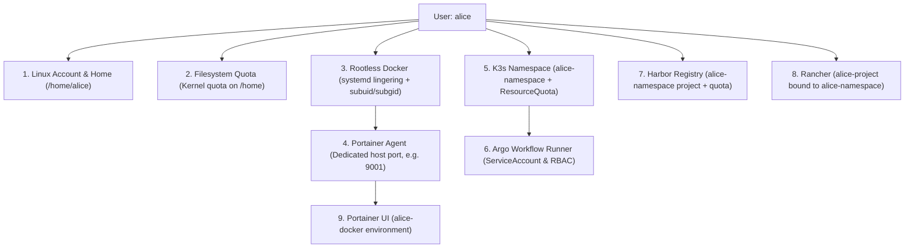

# User Setup Guide: Jihwija CLI & Manual Native Pipelines

This guide provides complete instructions for provisioning and managing multi-tenant users on the Turing Pi K3s cluster. You can provision and conduct user environments using either:

1. **Option A: Guided Automated Setup (Jihwija CLI)** — A streamlined CLI overlay (`jihwija`) that handles user account creation, quota configuration, password updates, and decommissioning with interactive prompts or scriptable flags.
2. **Option B: Manual Native Setup (The "OG" Pipeline)** — The original, direct operational workflow running plumbing scripts and native tools (`create-user.py`, `remove-user.py`, `change-user-quota.py`, `change-user-password.py`, `install-*`, `uninstall-*`) step-by-step.

Both approaches configure the identical underlying user infrastructure across seven integrated platform components: Linux user account, filesystem storage quotas, rootless Docker daemon, Portainer Agent endpoint, K3s namespace with RBAC and ResourceQuotas, Argo Workflows runner with namespace isolation, Harbor container registry project, Rancher cluster project, and Portainer environment.

---

## Prerequisites & Architecture (Common to Both Options)

### 1. Cluster Services & Credentials

Before provisioning users, ensure that the cluster infrastructure and services are deployed and healthy by following the **[Cluster Setup Guide](SETUP.md)**:

- **K3s Cluster:** The K3s server and agents must be active and Ready (`kubectl get nodes`).
- **Cluster Services:** Harbor, Rancher, Portainer, Argo Workflows, and cert-manager must be deployed (`jihwija deploy` or `./scripts/plumbing-scripts/deploy-services.py`).
- **Service Certificate Trust:** Ingress TLS certificates must be distributed to system stores and containerd (`jihwija trust certs` or `./scripts/plumbing-scripts/trust-k3s-certs.py`).
- **Administrator Credentials:** Configured in `/etc/jihwija/jihwija.env` (or exported in your shell):
  - `HARBOR_ADMIN_PASSWORD` and `HARBOR_HOSTNAME`
  - `RANCHER_TOKEN`, `RANCHER_HOSTNAME`, and `RANCHER_CLUSTER_ID` (default `local`)
  - `PORTAINER_API_KEY` and `PORTAINER_HOSTNAME`
  - `ARGO_HOSTNAME`
- **Sudo / Root Privileges:** User provisioning manages OS accounts, systemd services, and Kubernetes RBAC; commands must run with `sudo` or as `root`.

### 2. Filesystem Quota Prerequisites

Linux user disk quotas require the underlying filesystem containing `/home` to support quotas (ext4 or XFS mounted with the `usrquota` option):

- Enable quotas before provisioning users to enforce local storage limits.
- If you do not wish to enforce filesystem quotas, use the `--no-quota` flag during user creation.

### 3. Architecture of a Multi-Tenant User Environment

Provisioning a user creates an isolated, multi-tenant environment across 7 layers:



| Component | Resource Created | Description & Security Boundary |
| :--- | :--- | :--- |
| **Linux OS** | `/home/<user>` | System account with dedicated home directory, restricted permissions, and login shell. |
| **Filesystem Quota** | `/home` quota | Hard disk limit enforced by kernel quota system. |
| **Rootless Docker** | `dockerd-rootless.sh` | Unprivileged Docker daemon isolated to user namespace using dedicated `subuid`/`subgid` ranges (65536 IDs) and systemd user linger. |
| **Portainer Agent** | `portainer-agent.service` | Per-user systemd service listening on a dedicated host port (e.g. `9001`), connecting the rootless Docker socket to Portainer. |
| **K3s Namespace** | `<user>-namespace` | Private Kubernetes namespace with `admin` RoleBinding, LimitRange, ResourceQuota (CPU, memory, storage, GPU), and namespace-scoped kubeconfig at `~/.kube/config`. |
| **Argo Workflows** | `argo-workflow-runner` | Dedicated ServiceAccount with Pod/Service permissions for executing batch workflows, plus read-only access to cluster workflow templates. |
| **Harbor Registry** | `<user>-namespace` | Private container registry project, project admin role, and dedicated image storage quota. |
| **Rancher** | `<user>-project` | Dedicated Rancher project bound to `<user>-namespace` with Project Member permissions. |
| **Portainer** | `<user>-docker` | Portainer environment endpoint connected to the user's agent with exclusive user ownership. |

### 4. Automatic Shell Environment & Profile Integration

Jihwija installs global shell profile scripts into `/etc/profile.d/` so that users receive automatic access upon logging in:

1. **`/etc/profile.d/jihwija-kubeconfig.sh`**:
   - Detects the existence of `~/.kube/config`.
   - Automatically exports `KUBECONFIG="$HOME/.kube/config"` in login shells.
   - Prevents unprivileged users from accessing the restricted cluster administrator config at `/etc/rancher/k3s/k3s.yaml`.
2. **`/etc/profile.d/jihwija-argo-variables.sh`**:
   - Automatically sets `ARGO_SERVER="https://<ARGO_HOSTNAME>"`.
   - Derives `ARGO_TOKEN` from the active token inside the user's `~/.kube/config`.
   - Allows users to run `argo list` or `argo submit` immediately without authentication arguments.

### 5. Component Dependencies

When creating or removing selected components using `--only`, dependent services must be included:

| Component | Required Dependency | Notes |
| :--- | :--- | :--- |
| `rancher` | `k3s-namespace` | Rancher project binds to the user's K3s namespace. |
| `argo-workflow-runner` | `k3s-namespace` | The workflow runner ServiceAccount lives inside the namespace. |
| `portainer-agent` | `docker-rootless` | Portainer Agent requires a running rootless Docker socket. |
| `harbor` | None | Can be provisioned independently. |
| `portainer` | None | Account creation requires only the Portainer server. |
| `docker-rootless` | None | Operates independently under user lingering. |
| `k3s-namespace` | None | Can be created without other services. |

---

## Option A: Guided User Management with the Jihwija CLI

The Jihwija CLI provides intuitive, verb-first commands for all user lifecycle operations.

### 1. Enable Filesystem Storage Quotas

Enable Linux quota enforcement on the target partition containing user home directories:

```bash
sudo jihwija enable quotas /home
```

To disable quotas while preserving quota record files:
```bash
sudo jihwija disable quotas /home
```

### 2. Provision a User Interactively

To provision a user with guided prompts:

```bash
sudo jihwija add user alice
```

The interactive wizard will prompt for:
1. **Component Selection:** Press Enter for `all`, or enter a comma-separated list (e.g. `k3s-namespace,argo-workflow-runner,harbor`).
2. **Filesystem Quota:** e.g., `10GB` (or `500MB`).
3. **K3s CPU Quota:** Total CPU limit for the namespace (default: `2`).
4. **K3s Memory Quota:** Total memory limit (default: `6Gi`).
5. **K3s Storage Quota:** Persistent and ephemeral storage limit (default: `10Gi`).
6. **K3s GPU Quota:** Dedicated NVIDIA GPU limit (default: `1`).

Upon completion, `jihwija` prints a sensitive summary containing:
- Generated secure initial password.
- Service URLs for Harbor, Rancher, and Portainer.
- K3s namespace and kubeconfig location (`/home/alice/.kube/config`).
- Portainer Agent assigned port and environment name.

### 3. Non-Interactive & Automated User Provisioning

For scripts and automated pipelines, specify all parameters as command-line arguments:

```bash
sudo jihwija add user alice \
  --quota 10GB \
  --k3s-cpu-quota 4 \
  --k3s-memory-quota 8Gi \
  --k3s-storage-quota 20Gi \
  --k3s-gpu-quota 1
```

#### Provisioning Without Quotas

To skip all filesystem, Kubernetes, and Harbor storage quotas:

```bash
sudo jihwija add user alice --no-quota
```

#### Specifying Custom Shell and Verbose Logs

```bash
sudo jihwija add user alice \
  --quota 10GB \
  --shell /bin/zsh \
  --raw-logs
```

### 4. Component Filtering with `--only`

Use `-o` or `--only` to provision resources only for selected services. All required dependencies must be included:

```bash
# Provision only Kubernetes namespace, Argo workflow runner, and Harbor registry
sudo jihwija add user bob --only k3s-namespace,argo-workflow-runner,harbor

# Provision only rootless Docker and Portainer environment
sudo jihwija add user bob --only docker-rootless,portainer-agent,portainer

# Provision only Harbor registry account and project
sudo jihwija add user bob --only harbor
```

### 5. Updating User Passwords

Change a user's password across Linux, Harbor, and Rancher simultaneously:

```bash
sudo jihwija set user password alice
```

The command prompts for the new password with confirmation without echoing.

#### Automated Password Updates

Avoid passing passwords as process arguments:

```bash
# Read password from a protected file
sudo jihwija set user password alice --password-file /root/secrets/alice.pass

# Or pass via stdin
echo -n "NewSecurePass123!" | sudo jihwija set user password alice --stdin
```

> [!NOTE]
> Because Portainer does not expose an administrative password reset API for existing users, `set user password` automatically redeploys the user's Portainer account with the new credentials. If any external service password update fails, the Linux account password is not modified.

### 6. Updating User Quotas

Modify a user's Linux filesystem, Kubernetes ResourceQuota, and Harbor storage quotas:

```bash
# Interactive quota adjustment
sudo jihwija set user quota alice
```

Or adjust individual quotas directly via flags:

```bash
# Update only Linux filesystem quota
sudo jihwija set user quota alice --linux-quota 20GB

# Update K3s namespace quotas
sudo jihwija set user quota alice \
  --k3s-cpu-quota 4 \
  --k3s-memory-quota 16Gi \
  --k3s-storage-quota 50Gi \
  --k3s-gpu-quota 2

# Update Harbor project storage quota
sudo jihwija set user quota alice --harbor-storage-quota 25GB
```

### 7. Decommissioning and Removing Users

Remove all platform resources associated with a user:

```bash
# Interactive removal (prompts for confirmation and home directory deletion)
sudo jihwija remove user alice
```

#### Non-Interactive Removal and Data Purging

```bash
# Remove platform resources and purge the home directory and Docker data
sudo jihwija remove user alice --purge-data --yes

# Remove platform resources but PRESERVE user home directory
sudo jihwija remove user alice --no-purge-data --yes
```

#### Partial Service Teardown

Remove resources only for specific components:

```bash
sudo jihwija remove user alice --only harbor,rancher
```

> [!IMPORTANT]
> If a Linux account existed on the host *prior* to Jihwija provisioning, Jihwija tracks it as pre-existing in its state file. Running `jihwija remove user` will tear down its Kubernetes, Docker, and service resources while safely preserving the pre-existing Linux user and home directory.

### 8. User Login Experience & Verification

Once provisioned, the user can log into the server and begin working immediately:

```bash
ssh alice@<k3s_server_ip>
```

#### Verify Kubernetes Access

The user's login shell automatically uses `/home/alice/.kube/config`:

```bash
# View resources in the user's private namespace
kubectl get pods
kubectl get resourcequotas
```

#### Verify Argo Workflows

The user can submit workflows using the auto-configured runner:

```bash
# List workflows
argo list

# Submit a sample workflow in the user namespace
argo submit --watch argo/flask-hello-world-argo/workflow.yml
```

For an end-to-end walkthrough on running workflow pipelines, see **[Deploying an Argo Workflow](DEPLOYING_ARGO_WORKFLOW.md)**.

#### Verify Rootless Docker

```bash
# Run a rootless container
docker run --rm hello-world

# Verify Docker Compose
docker compose version
```

#### Verify Harbor Registry and Web Dashboards

```bash
# Log in to the local Harbor registry using assigned credentials
docker login harbor.<your-cluster-domain>
```

To access web UIs (Harbor, Rancher, Portainer, Argo) from an external workstation, see **[Web UI Tunneling](TUNNELING.md)**.

---

## Option B: Manual Native Setup (Plumbing Scripts)

Maintainers who prefer direct execution can run each underlying plumbing script without the `jihwija` CLI wrapper.

Plumbing executables live in `scripts/plumbing-scripts/`:

```
scripts/plumbing-scripts/
├── create-user.py                    # High-level provisioning orchestrator
├── remove-user.py                    # High-level teardown orchestrator
├── change-user-quota.py              # High-level quota updater
├── change-user-password.py           # High-level password synchronizer
├── enable-quotas.py                  # Filesystem quota initializer
├── disable-quotas.py                 # Filesystem quota deactivator
├── install-docker-rootless.py        # Rootless Docker installer
├── install-portainer-agent.py        # Per-user Portainer Agent installer
├── install-k3s-namespace.py          # K3s namespace & kubeconfig generator
├── install-argo-workflow-runner.py   # Argo workflow runner & RBAC installer
├── install-harbor-account.py         # Harbor user & project creator
├── install-rancher-account.py        # Rancher user & project creator
├── install-portainer-account.py      # Portainer user & endpoint creator
├── set-harbor-password.py            # Harbor password updater
├── set-rancher-password.py           # Rancher password updater
├── set-harbor-quota.py               # Harbor project quota updater
├── set-k3s-quota.py                  # K3s ResourceQuota updater
└── uninstall-*                    # Individual component teardown scripts
```

### 1. Enable Filesystem Quotas

Enable quotas on the filesystem containing `/home`:

```bash
sudo ./scripts/plumbing-scripts/enable-quotas.py /home
```

This verifies that `/etc/fstab` contains the `usrquota` mount option, runs `quotacheck -cum /home`, and activates quotas with `quotaon -u /home`.

### 2. Install Global Shell Profile Scripts

Install the profile scripts that configure `KUBECONFIG` and Argo environment variables for users upon login:

```bash
# Install Kubeconfig profile
sudo install -D -o root -g root -m 644 \
  ./etc/profile.d/jihwija-kubeconfig.sh \
  /etc/profile.d/jihwija-kubeconfig.sh

# Render and install Argo variables profile (substitute your Argo FQDN)
sed "s|@ARGO_HOSTNAME@|argo.example.test|g" \
  ./etc/profile.d/jihwija-argo-variables.sh | \
  sudo install -D -o root -g root -m 644 /dev/stdin /etc/profile.d/jihwija-argo-variables.sh
```

### 3. Configure Service Credentials in Environment

Ensure your administrative tokens and service endpoints are exported:

```bash
export HARBOR_HOSTNAME="harbor.example.test"
export HARBOR_ADMIN_PASSWORD="YourHarborAdminPassword"
export RANCHER_HOSTNAME="rancher.example.test"
export RANCHER_TOKEN="token-..."
export RANCHER_CLUSTER_ID="local"
export PORTAINER_HOSTNAME="portainer.example.test"
export PORTAINER_API_KEY="ptr_..."
export ARGO_HOSTNAME="argo.example.test"
```

Or load them directly from your configuration file:
```bash
set -a
source etc/jihwija.env
set +a
```

### 4. High-Level Native Provisioning (`create-user.py`)

Run the main provisioning orchestrator directly:

```bash
sudo -E ./scripts/plumbing-scripts/create-user.py -u bob \
  --quota 10GB \
  --k3s-cpu-quota 2 \
  --k3s-memory-quota 6Gi \
  --k3s-storage-quota 10Gi \
  --k3s-gpu-quota 1
```

To run with unbuffered, raw command output:
```bash
sudo -E ./scripts/plumbing-scripts/create-user.py -u bob --raw-logs
```

### 5. Direct Component-by-Component Plumbing Execution

If you need complete control or want to provision components individually:

#### Step 5.1: Create Linux Account and Filesystem Quota
```bash
# Create user
sudo useradd --create-home --shell /bin/bash bob
echo "bob:InitialPassword123!" | sudo chpasswd

# Set filesystem quota (10GB soft / 10GB hard)
sudo setquota -u bob 10485760 10485760 0 0 /home
```

#### Step 5.2: Install Rootless Docker
```bash
sudo ./scripts/plumbing-scripts/install-docker-rootless.py -u bob
```
This enables systemd user lingering (`loginctl enable-linger bob`), configures `/etc/subuid` and `/etc/subgid`, runs `dockerd-rootless-setuptool.sh`, and installs Docker Compose.

#### Step 5.3: Install Portainer Agent
```bash
sudo ./scripts/plumbing-scripts/install-portainer-agent.py \
  -u bob \
  -H $PORTAINER_HOSTNAME \
  --port 9001
```
This starts the Portainer Agent container inside the user's rootless Docker daemon, binding to host port `9001`.

#### Step 5.4: Create K3s Namespace & Kubeconfig
```bash
sudo ./scripts/plumbing-scripts/install-k3s-namespace.py \
  -u bob \
  --cpu-quota 2 \
  --memory-quota 6Gi \
  --storage-quota 10Gi \
  --gpu-quota 1
```
This creates:
- Namespace `bob-namespace`
- ServiceAccount `bob-user`
- RoleBinding granting `admin` on `bob-namespace`
- ResourceQuota limiting CPU, memory, storage, and GPUs
- Namespace-scoped kubeconfig at `/home/bob/.kube/config` (chowned to `bob:bob`, permissions `0600`)

#### Step 5.5: Install Argo Workflow Runner
```bash
sudo ./scripts/plumbing-scripts/install-argo-workflow-runner.py \
  -u bob \
  -n bob-namespace
```
This creates the `argo-workflow-runner` ServiceAccount in `bob-namespace` with RBAC permissions for workflow executor Pods and temporary Services.

#### Step 5.6: Create Harbor User and Project
```bash
USER_PASSWORD="InitialPassword123!" \
HARBOR_ADMIN_PASSWORD="$HARBOR_ADMIN_PASSWORD" \
sudo -E ./scripts/plumbing-scripts/install-harbor-account.py \
  -u bob \
  -H $HARBOR_HOSTNAME
```

#### Step 5.7: Create Rancher User and Project
```bash
USER_PASSWORD="InitialPassword123!" \
RANCHER_TOKEN="$RANCHER_TOKEN" \
sudo -E ./scripts/plumbing-scripts/install-rancher-account.py \
  -u bob \
  -H $RANCHER_HOSTNAME \
  --cluster-id local
```

#### Step 5.8: Create Portainer User and Environment
```bash
USER_PASSWORD="InitialPassword123!" \
PORTAINER_API_KEY="$PORTAINER_API_KEY" \
sudo -E ./scripts/plumbing-scripts/install-portainer-account.py \
  -u bob \
  -H $PORTAINER_HOSTNAME \
  --agent-address "$(hostname -f):9001" \
  --agent-port 9001
```

### 6. Native Password & Quota Management

#### Synchronize Passwords
```bash
# Interactive or via stdin
echo -n "NewSecurePassword123!" | \
sudo -E ./scripts/plumbing-scripts/change-user-password.py -u bob --stdin
```

Or update individual services:
```bash
# Update Harbor password only
USER_PASSWORD="NewPass" sudo -E ./scripts/plumbing-scripts/set-harbor-password.py -u bob -H $HARBOR_HOSTNAME

# Update Rancher password only
USER_PASSWORD="NewPass" sudo -E ./scripts/plumbing-scripts/set-rancher-password.py -u bob -H $RANCHER_HOSTNAME
```

#### Update Quotas
```bash
sudo -E ./scripts/plumbing-scripts/change-user-quota.py bob \
  --linux-quota 20GB \
  --k3s-cpu-quota 4 \
  --k3s-memory-quota 16Gi \
  --k3s-storage-quota 50Gi \
  --k3s-gpu-quota 2 \
  --harbor-storage-quota 20GB
```

Or update individual quotas:
```bash
# Update K3s namespace quota only
sudo ./scripts/plumbing-scripts/set-k3s-quota.py -u bob \
  --cpu-quota 4 --memory-quota 16Gi --storage-quota 50Gi --gpu-quota 2

# Update Harbor project quota only
sudo -E ./scripts/plumbing-scripts/set-harbor-quota.py -u bob \
  -H $HARBOR_HOSTNAME \
  --storage-quota-bytes 21474836480
```

### 7. Native User Teardown & Decommissioning

#### High-Level Orchestrated Teardown
```bash
sudo -E ./scripts/plumbing-scripts/remove-user.py -u bob --purge-data --yes
```

#### Individual Component Teardown Scripts

To remove individual components in reverse dependency order:

```bash
# 1. Portainer account and environment
sudo -E ./scripts/plumbing-scripts/uninstall-portainer-account.py -u bob -H $PORTAINER_HOSTNAME

# 2. Portainer agent container
sudo ./scripts/plumbing-scripts/uninstall-portainer-agent.py -u bob

# 3. Rancher project and user
sudo -E ./scripts/plumbing-scripts/uninstall-rancher-account.py -u bob -H $RANCHER_HOSTNAME

# 4. Harbor project and user
sudo -E ./scripts/plumbing-scripts/uninstall-harbor-account.py -u bob -H $HARBOR_HOSTNAME

# 5. Argo workflow runner RBAC
sudo ./scripts/plumbing-scripts/uninstall-argo-workflow-runner.py -u bob -n bob-namespace

# 6. K3s namespace and kubeconfig
sudo ./scripts/plumbing-scripts/uninstall-k3s-namespace.py -u bob

# 7. Rootless Docker and lingering
sudo ./scripts/plumbing-scripts/uninstall-docker-rootless.py -u bob
```

### 8. Per-User State Tracking (`scripts/state/<username>.json`)

Jihwija persists component state in `/opt/jihwija/scripts/state/<username>.json` (permissions `0600`, directory `0700`):

```json
{
  "username": "bob",
  "uid": 1002,
  "home": "/home/bob",
  "linux_user": true,
  "linux_user_created": true,
  "quota": "10GB",
  "filesystem_quota": true,
  "docker_rootless": true,
  "portainer_agent": true,
  "agent_port": 9001,
  "agent_address": "server-01.example.test:9001",
  "k3s_namespace": true,
  "namespace": "bob-namespace",
  "k3s_service_account": "bob-user",
  "k3s_cpu_quota": "2",
  "k3s_memory_quota": "6Gi",
  "k3s_storage_quota": "10Gi",
  "k3s_gpu_quota": "1",
  "argo_workflow_runner": true,
  "harbor_account": true,
  "harbor_project": "bob-namespace",
  "harbor_storage_quota_bytes": 10737418240,
  "rancher_account": true,
  "rancher_project": "bob-project",
  "portainer_account": true,
  "portainer_environment": "bob-docker"
}
```

- **Reconciliation & Idempotency:** The state file records which components were provisioned so subsequent quota updates or removals know exactly what resources exist.
- **Pre-existing Linux Accounts:** If `linux_user_created` is `false`, `remove-user.py` avoids deleting the host Linux account or home directory.

---

## Command Reference

See the dedicated **[CLI Command Reference](CLI_REFERENCE.md)** for managed-user
CLI routes and the corresponding directly executable plumbing commands.
